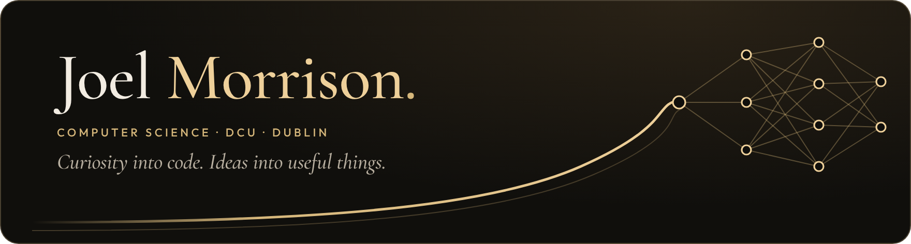
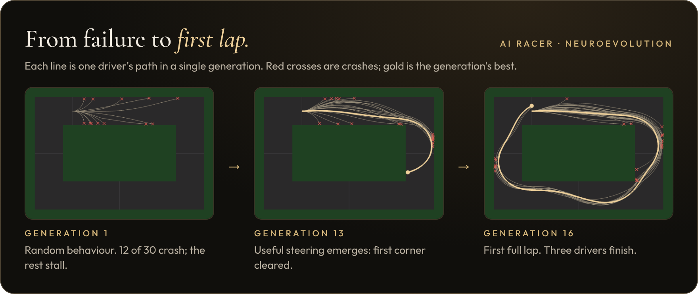
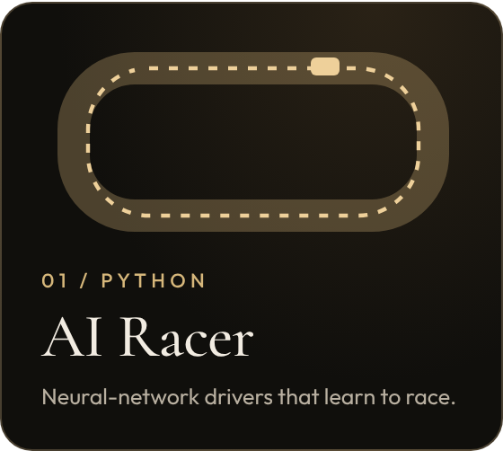
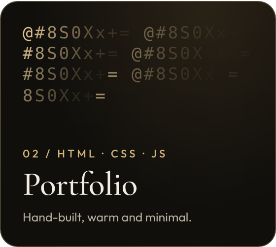
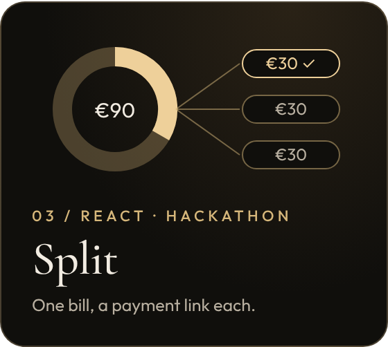

I'm a second-year Computer Science student at DCU who builds things to understand how they work, from neural networks that learn to drive to web apps made at hackathons. I'm drawn to Python, practical AI and interfaces that feel considered.

**[Portfolio](https://joelmorrison121-cpu.github.io/)** · **[LinkedIn](https://www.linkedin.com/in/joel-morrison-16a304389/)** · **[Email](mailto:joelmorrison121@gmail.com)**

 

**[AI Racer](https://github.com/joelmorrison121-cpu/AI_racer)**: a Python racing game where 30 neural-network drivers per generation learn by selection and mutation. Four tracks, a race-the-champion mode, and experiments on tracks the drivers have never seen. [Watch the demo ↗](https://joelmorrison121-cpu.github.io/ai-racing.html)

 

<table>
  <tr>
    <td width="33%"></td>
    <td width="33%"></td>
    <td width="33%"></td>
  </tr>
  <tr>
    <td valign="top">Python · Pygame · neuroevolution. <a href="https://github.com/joelmorrison121-cpu/AI_racer">Code</a> · <a href="https://joelmorrison121-cpu.github.io/ai-racing.html">Build notes</a></td>
    <td valign="top">HTML, CSS and JavaScript with a WebGL ASCII background. <a href="https://joelmorrison121-cpu.github.io/">Live site</a> · <a href="https://github.com/joelmorrison121-cpu/joelmorrison121-cpu.github.io">Code</a></td>
    <td valign="top">Hackathon bill-splitter. I built the React frontend. <a href="https://splitpay-pzjgc2pw.manus.space">Demo</a> · <a href="https://github.com/joelmorrison121-cpu/SolanaHackathon26">Backend</a></td>
  </tr>
</table>

### On my workbench

Teaching AI Racer's drivers to handle hairpins they've never seen. Drivers trained on the hardest track generalise best; one now laps all four circuits. Next I'm trying a different track each generation. Up next: a Huffman file compressor in C.

Away from the keyboard, I'm on the council of DCU Photography Society.

<b>More about my projects</b>

 

**AI Racer.** Each car sees through seven distance rays plus its speed and the direction to the next checkpoint, giving 11 inputs to an 11 → 8 → 3 network. Weights stay fixed during a lap; learning happens between generations, as the best two networks are kept and the rest are mutated copies or fresh random drivers. Version 2 added curved tracks built from a centre-line path, checkpoints at any angle, progress measured along the route, a reward for faster laps, save/resume, live progress graphs and multi-seed experiments.

**Portfolio.** No framework and no build step. It has keyboard-friendly navigation, respects reduced-motion settings, and the videos don't download until you press play.

**Split.** A five-person hackathon team at BUILD IRL Vol. 1. The backend creates bills, issues per-person payment links and has ten passing tests. We didn't join the frontend and backend up before the deadline, which taught me to agree API contracts early.

**Leap.** My own entry at the Manus AI Dublin Build Challenge: a wait-or-switch commute planner for Dublin. [Try it ↗](https://commutecut-jcdm7heo.manus.space/)

